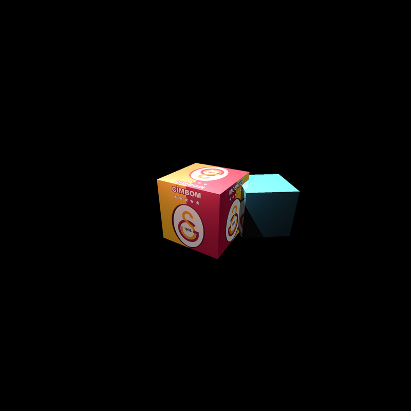
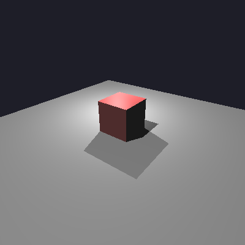
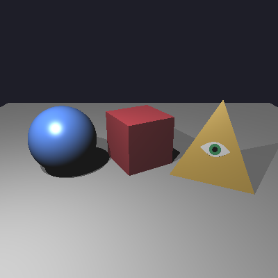
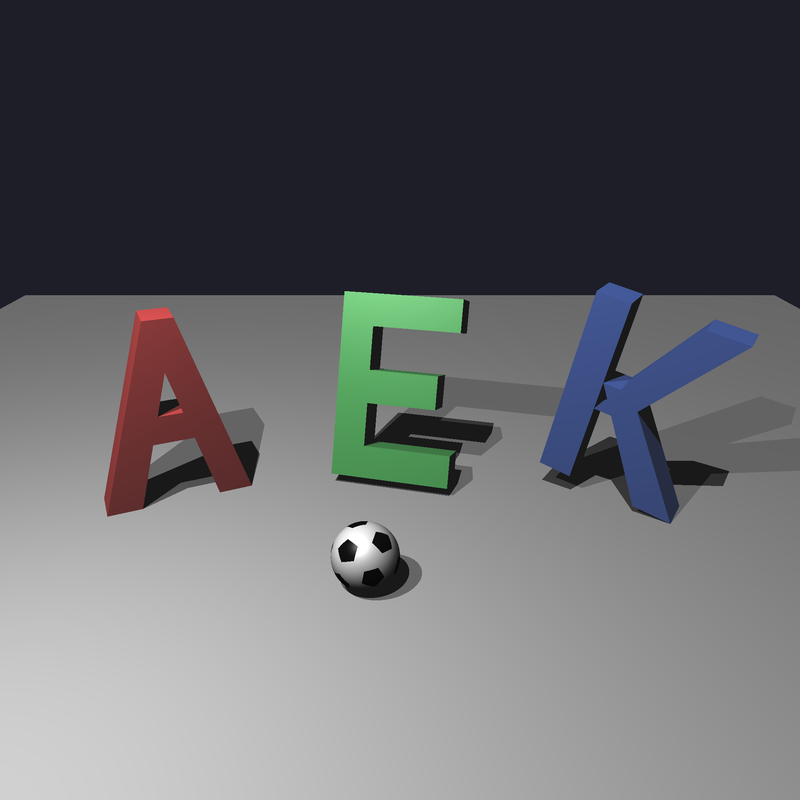
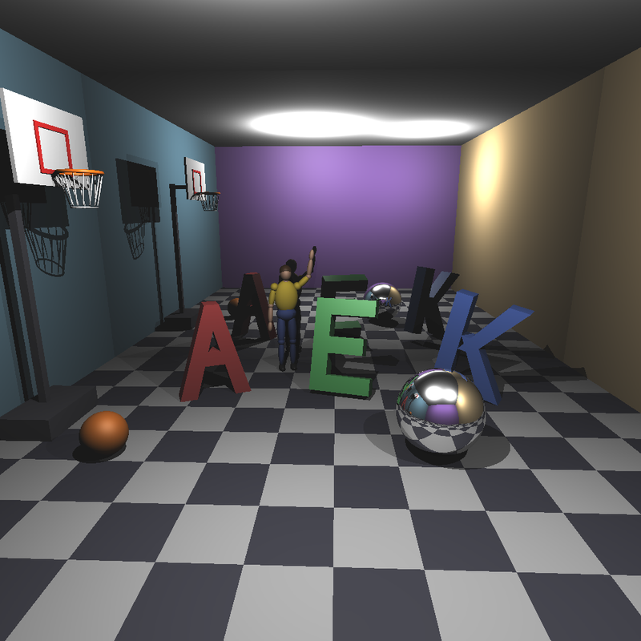
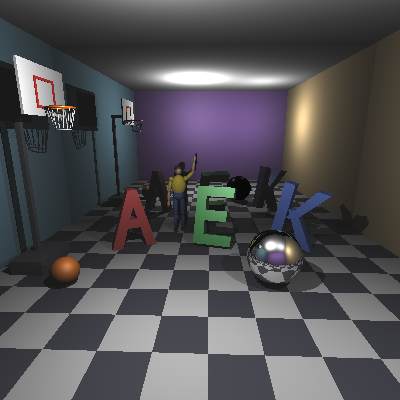

# CSE 461 PA1: Ray Tracer

This program is a ray tracer. It reads a scene from an XML file and writes the image to a PNG file.

The program has these features:

- Triangle meshes (the only primitive)
- Mesh instances with translation, rotation and scaling
- A Bounding Volume Hierarchy (BVH) for each mesh
- Multithreading on all CPU cores
- Blinn-Phong shading with point lights and triangular (directional) lights
- Shadows
- Recursive mirror reflection
- Texture mapping

## 1. Requirements

- C++11 or higher but preferably C++17 compiler (I tested with Apple clang 17)
- CMake 3.16 or newer

All third-party code is in the `third_party/` folder. You do not have to install other libraries.

## 2. Build

Run these commands in the project folder:

```bash
cmake -S . -B build
cmake --build build
```

The default build type is `Release`. The compiler uses full optimization (`-O3`).


## 3. Run

The program needs two arguments: the scene file and the output image. The third argument is optional.

```bash
./build/raytracer <scene.xml> <output.png> [--no-bvh]
```

| Argument | Meaning |
|---|---|
| `<scene.xml>` | The scene file to render |
| `<output.png>` | The output image |
| `--no-bvh` | Optional. Turns the BVH off. The program then tests all triangles for each ray (brute force). |

Examples:

```bash
./build/raytracer scenes/example_scene.xml example_scene.png
```

```bash
./build/raytracer scenes/bvh_test.xml bvh_test.png --no-bvh
```

The program writes the BVH mode (on or off), a short summary of the scene and the render time to the terminal.

If the scene file has an error, the program writes an error message and stops. The message tells the XML tag or the index that has the error.

The texture path in the scene file is relative to the folder of the scene file. Thus, you can run the program from any folder.

The program uses all CPU cores. It gets the number of cores from `std::thread::hardware_concurrency()`.

## 4. Project structure

| File | Content |
|---|---|
| `src/main.cpp` | Reads the arguments, loads the scene, builds the BVHs and the instance matrices, starts the threads, writes the PNG |
| `src/vec3.h` | 3D vector and its operations (dot, cross, normalize, reflect) |
| `src/mat4.h` | 4x4 matrix: translation, scaling, rotation, transpose, point and direction transform |
| `src/ray.h` | Ray: origin and direction |
| `src/camera.h/.cpp` | Camera and primary ray generation |
| `src/triangle.h/.cpp` | Ray-triangle intersection |
| `src/bvh.h/.cpp` | Bounding boxes, ray-box test, BVH build |
| `src/render.h/.cpp` | Closest hit and any hit (with and without BVH), shading |
| `src/texture.h/.cpp` | Texture loading and sampling |
| `src/scene.h`, `src/scene_parser.cpp` | Scene data and XML parser |
| `tests/test_vec3.cpp` | Unit tests for `vec3.h` |
| `scenes/` | Test scenes and the texture image |
| `tools/` | Python scripts that make the test scenes |

## 5. BVH

### 5.1 Structure

Each mesh has its own BVH. An instance uses the BVH of its base mesh, in local space. Thus, we build each BVH only one time.

The BVH is a binary tree. We keep all nodes in one array (`std::vector<BVHNode>`). Node 0 is the root. A node points to its children with array indices, not with pointers.

```cpp
struct BVHNode {
  AABB box;                  // bounding box of all triangles in this node
  int left = -1, right = -1; // inner node: indices of the two children
  int start = 0, count = 0;  // leaf: triangles faceOrder[start .. start+count)
};
```

A node with `count > 0` is a leaf. The BVH also has an array `faceOrder`. It holds the triangle indices. The build sorts this array, so the triangles of each node are next to each other.

### 5.2 Build

The build is recursive. For a range of triangles, it does these steps:

1. Calculate the bounding box of all triangles in the range.
2. If the range has 4 triangles or fewer, make a leaf and stop.
3. Find the longest axis of the box (x, y or z).
4. Split the range at the median. We use `std::nth_element` with the triangle centroids on the longest axis. After this step, the left half has the smaller centroids, and the right half has the larger centroids.
5. Build the left child and the right child with the two halves.

A median split always gives two halves of equal size. Thus, the tree is balanced, and its depth is about `log2(N / 4)`.

### 5.3 Ray-box test (slab method)

A box is the intersection of three slabs (one slab for each axis). For each axis, we calculate the `t` values where the ray goes into and out of the slab. We keep the latest entry and the earliest exit. If the exit is before the entry, the ray does not hit the box.

```
for each axis a:
    t0 = (box.min[a] − o[a]) / d[a]
    t1 = (box.max[a] − o[a]) / d[a]
    if t0 > t1: swap(t0, t1)
    tmin = max(tmin, t0)
    tmax = min(tmax, t1)
    if tmax < tmin: return false
return true
```

### 5.4 Traversal

**Closest hit** (primary rays and reflection rays):

1. If the ray does not hit the box of the node, stop. We use the current closest `t` as `tmax`. Thus, we also skip all boxes that are farther than the closest hit.
2. If the node is a leaf, test its triangles. If a triangle is closer, keep it and make the closest `t` smaller.
3. If the node is an inner node, go into **both** children. We do not stop after the left child, because the right child can have a closer triangle.

**Any hit** (shadow rays):

The steps are the same, but we stop at the first hit. A shadow ray only needs to know if there is an object between the point and the light.

### 5.5 BVH on and off

The `--no-bvh` argument turns the BVH off (see section 3). Then the program uses the brute-force search. The brute-force search tests all triangles for each ray. We keep both methods to compare the render times (section 8).

## 6. Multithreading

Each pixel is independent from the other pixels. Thus, the threads do not have to wait for each other.

We start one thread for each CPU core. The threads share one atomic counter, `nextRow`. Each thread does these steps:

1. Get the next row number from the counter (`nextRow++`). The atomic counter makes sure that two threads never get the same row.
2. If no rows are left, stop.
3. Render all pixels of this row.
4. Go to step 1.

With this method, a fast thread takes more rows. Thus, all threads work until the end. (If each thread gets a fixed part of the image, a thread with only background pixels stops early and waits.)

The scene and the BVHs are read-only during the render. Each pixel has exactly one writer thread. Thus, we do not need locks.

## 7. Test scenes

| Scene file | Triangles | What it tests |
|---|---|---|
| `scenes/example_scene.xml` | 12 + 1 instance | Example from the assignment: instancing, texture, mirror |
| `scenes/shadow_test.xml` | 14 | Shadows of a point light and a triangular light |
| `scenes/bvh_test.xml` | 22,274 | BVH performance: sphere, cube, pyramid with an eye |
| `scenes/letters_test.xml` | 23,522 | Letters A, E, K at different angles and a football |
| `scenes/mirror_test.xml` | 42,042 | Mirror wall and mirror sphere in a closed room |

The Python scripts in `tools/` make the large test scenes. You can make a scene with more or fewer triangles:

```bash
python3 tools/make_bvh_test.py --level 6 --out scenes/bvh_test_big.xml
```

## 8. Render times

### 8.1 Test computer and method

- Computer: Apple M4 (10 cores: 4 performance cores and 6 efficiency cores), 16 GB memory
- Operating system: macOS 26.6
- Compiler: Apple clang 17, `Release` build (`-O3`)

The times show only the render (the pixel loop). They do not include the XML parse and the BVH build. I show the BVH build time in a separate column.

For runs shorter than 1 second, I did 5 runs and show the median. The program shows the time in milliseconds. Thus, very short times are not precise.

### 8.2 BVH and multithreading with different triangle counts

For this test, we made the `bvh_test` scene with 4 different sphere levels (`tools/make_bvh_test.py --level 3/4/5/6`). The image size is 400 × 400. The scene has one point light and one triangular light. Thus, each hit point sends up to 2 shadow rays.

| Triangles | No BVH, 1 thread | No BVH, 10 threads | BVH, 1 thread | BVH, 10 threads | BVH build |
|---:|---:|---:|---:|---:|---:|
| 3,074 | 6.01 s | 1.06 s | 0.033 s | 0.007 s | 0.5 ms |
| 6,914 | 15.57 s | 2.97 s | 0.040 s | 0.007 s | 1.5 ms |
| 22,274 | 54.93 s | 9.15 s | 0.044 s | 0.009 s | 5.8 ms |
| 83,714 | 209.42 s | 38.04 s | 0.048 s | 0.008 s | 23.4 ms |

Speedup of the BVH (1 thread):

| Triangles | No BVH / BVH |
|---:|---:|
| 3,074 | 182× |
| 6,914 | 389× |
| 22,274 | 1,248× |
| 83,714 | 4,363× |

Results:

- **Without the BVH**, the render time increases linearly with the triangle count. The triangle count increases 27 times (3,074 to 83,714), and the time increases 35 times. Each ray tests all triangles.
- **With the BVH**, the render time is almost constant. The triangle count increases 27 times, but the time increases only 1.5 times. Each ray tests only a few boxes and triangles, because the tree depth is about `log2(N)`.
- The BVH build is fast. For 83,714 triangles, it takes 23 ms. One render without the BVH takes about 9,000 times longer.
- **Multithreading** makes the brute-force render 5 to 6 times faster.

### 8.3 Multithreading with different thread counts

The BVH renders in the previous table are too short to measure the thread speedup. Thus, we used a larger render for this test: `mirror_test` (42,042 triangles, mirror depth 6, 2 point lights) at 1600 × 1600, with the BVH.

| Threads | Render time | Speedup |
|---:|---:|---:|
| 1 | 1.351 s | 1.00× |
| 2 | 0.737 s | 1.83× |
| 4 | 0.426 s | 3.17× |
| 6 | 0.342 s | 3.95× |
| 8 | 0.293 s | 4.61× |
| 10 | 0.287 s | 4.71× |

Results:

- Up to 4 threads, the speedup is almost linear. The operating system puts these threads on the 4 performance cores.
- After 4 threads, the speedup is smaller. The other 6 cores are efficiency cores. They are slower than the performance cores.
- On a computer with equal cores, we expect a speedup near the core count.

## 9. Screenshots

All images are in the `screenshots/` folder. The scenes are in the `scenes/` folder.

### Example scene from the assignment (`example_scene.xml`)

The second cube is an instance of the first cube (translation, rotation 35° around the y axis, scaling 0.75). The first cube has a texture (`texturefactor` 0.4) and a small mirror coefficient.



### Shadows (`shadow_test.xml`)

The point light makes the large dark shadow in front of the cube. The triangular light makes the second, lighter shadow behind the cube.



### BVH test (`bvh_test.xml`, 22,274 triangles)



### Letters and a football (`letters_test.xml`, 23,522 triangles)



### Mirrors (`mirror_test.xml`, 42,042 triangles)

The back wall and the front sphere are mirrors. The room also has the letters A, E, K, a human model and a basketball hoop.

With `maxraytracedepth` 6:



With `maxraytracedepth` 1: the image of the mirror sphere in the mirror wall is black, because the second reflection is not calculated.



## Extra: Move the camera with the keyboard

The script `tools/cam_gaze_listener.py` lets you move through a scene. When you push a key, the script changes the camera in the scene file and renders the image again. Thus, you get a simple "walk through the scene" effect.

### How it works

1. The script reads `<position>` and `<gaze>` from the `<camera>` tag of the scene file.
2. It changes the gaze with two angles: yaw (turn left and right) and pitch (look up and down).
3. After each key, it writes the new camera values to the scene file. It does not change other parts of the file.
4. It runs the ray tracer. The ray tracer writes the new image.
5. When you stop the script, it writes the original scene file back.

### Usage

Build the ray tracer first (see section 2). Then run the script from the project folder:

```bash
python3 tools/cam_gaze_listener.py -s scenes/letters_test.xml
```

Open the output image (`camera_view.png`) in an image viewer that reloads the file automatically. Then push the keys in the terminal.

| Key | Action |
|---|---|
| `a` / `d` | Turn left / right (around the world up axis) |
| `w` / `s` | Look up / down |
| Up arrow / Down arrow | Move forward / backward (in the gaze direction) |
| Left arrow / Right arrow | Move left / right |
| `q` | Stop the script |

Options:

| Option | Default | Meaning |
|---|---|---|
| `-s`, `--scene` | (required) | The scene file |
| `-b`, `--binary` | `./build/raytracer` | The ray tracer program |
| `-o`, `--output` | `camera_view.png` | The output image |
| `--angle-step` | `5.0` | Turn angle for each key, in degrees |
| `--move-step` | `0.5` | Move distance for each key |

Notes:

- The script works on macOS and Linux. It uses the `termios` module, which is not available on Windows.
- The pitch stops at ±89°. At 90°, the gaze is parallel to the up vector, and the camera cannot calculate the `u` vector (`cross(up, w) = 0`).
- The script changes the scene file while it runs. If the script stops with Ctrl+C, it also writes the original file back.
- With the BVH and multithreading, a new image takes less than 0.2 seconds for the test scenes. Thus, the movement is almost real-time.

## Third-party libraries

| Library | Version | Source | Purpose |
|---|---|---|---|
| pugixml | v1.16 | https://github.com/zeux/pugixml | XML scene parsing |
| stb_image | v2.32 (commit `9600522`) | https://github.com/nothings/stb | Texture loading |
| stb_image_write | v1.18 (commit `9600522`) | https://github.com/nothings/stb | PNG output |

All other code (vector and matrix math, ray intersection, BVH, shading) is our own code.
